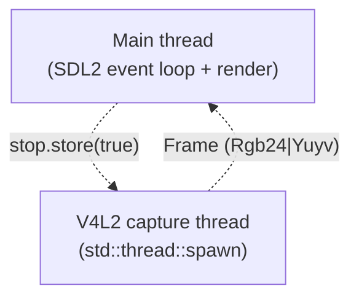

# Annotator — Open Work Plan

Single source of truth for everything that is **not** done yet.

Everything that was completed has been removed from this file.  If a feature
is not listed here, it is shipped and working.

Last updated: 2026-11-07

---

## 1. Verification of current state

Confirmed by reading the source on 2026-11-07:

| Item | Status | Evidence |
|---|---|---|
| `cargo fmt --check` | clean | CI runs it |
| `cargo clippy --all-targets -- -D warnings` | 0 warnings | CI runs it |
| `cargo test` | 17 passed | `scripts/test.sh` |
| x86_64 build + run | works | `target/x86_64/annotator` |
| aarch64 build | works | `target/aarch64/annotator` |
| R6A hardware | **validated** | ran on a real R6A with the device loader |

All previously planned performance work (the old "perf TODO 1–11" list) is
**done**: parallel rasterisation with rayon, double-buffered pipeline,
background rasteriser thread, GPU-cached text textures, static icon table,
snapshot dirty flag, GPU-primitive active strokes, thick-line rewrite and
preview-buffer reuse are all in `src/`.

---

## 2. Open items

Ordered by priority.  Each item states the problem, the plan, and how to
verify it.

### P1 — Portal action buttons are dead

**Problem.** The web portal renders `Undo`, `Redo`, `Clear Canvas` and
`Freeze Frame` buttons (`src/api.rs`, `PORTAL_HTML`).  Their handlers call:

```js
api('/tool?name=undo', {method:'POST'})
api('/tool?name=redo', {method:'POST'})
api('/tool?name=clear', {method:'POST'})
api('/tool?name=freeze', {method:'POST'})
```

But `/api/v1/tool` only accepts a real tool name — `Tool::from_name` in
`src/tools.rs` matches `pen|line|rect|circle|arrow|text|select|eraser|highlight|laser`
and returns `None` for anything else.  So all four buttons get a **400
`unknown tool 'undo'`** and do nothing.

The old REST plan had deliberately descoped these as remote-control
endpoints.  The buttons were left in the portal anyway, so the portal
ships with four visible controls that cannot work.

**Plan.**

1. Add a `ApiCommandKind` variant per action in `src/state.rs`:
   `Undo`, `Redo`, `Clear`, `ToggleFreeze`.
2. Extend `control_command()` in `src/api.rs` with dedicated routes:
   - `POST/GET /api/v1/undo`
   - `POST/GET /api/v1/redo`
   - `POST/GET /api/v1/clear`
   - `POST/GET /api/v1/freeze?on=1|0|toggle`
3. Handle them in the main loop's API drain (`src/main.rs`), next to the
   existing `SetTool` / `SetColor` / `SetBrushSize` / `SetInput` arms:
   - `Undo` → `state.scene.undo()`, reject with 409 when the stack is empty
   - `Redo` → `state.scene.redo()`, reject with 409 when the stack is empty
   - `Clear` → `state.scene.clear()` (always ok; it pushes undo first)
   - `ToggleFreeze` → flip `state.freeze_frame`
   All four must call `state.mark_snapshot_dirty()`.
4. Repoint the portal buttons at the new routes.
5. Keep the action names (`undo`, `redo`, `clear`, `freeze`) rejected by
   `/api/v1/tool` so a tool name stays unambiguous.

**Verify.** `curl -X POST http://host:8080/api/v1/undo` → 200 or 409;
the same via the portal buttons; `cargo test` still green.

---

### P2 — `?fmt=text` is documented but not implemented

**Problem.** The REST plan and the Crestron integration notes promise
`?fmt=text` returning plain `OK …` / `ERR …` lines so a Crestron Pro3 can
parse replies without a JSON parser.  The code only ever parses `fmt` —
`grep fmt src/api.rs` finds the query split, one test that asserts the
parameter is decoded, and nothing that uses it.  Every response is JSON.

This matters because the Pro3 is the primary consumer of the API and SIMPL
has no JSON parser.

**Plan.**

1. Add `fn wants_text(req: &Request) -> bool` — true when the merged
   params contain `fmt=text` (query string or POST body).
2. Add a text renderer for the three read endpoints:
   - `/api/v1/health` → `OK version=0.1.0`
   - `/api/v1/state` → `OK tool=pen color=ff3333 size=8 input=1 inputs=2 freeze=0 …`
   - `/api/v1/inputs` → `OK active=1` followed by one `input=<index>:<name>`
     line per device
3. Add a text renderer for the control endpoints:
   - success → `OK <key>=<value>` lines
   - failure → `ERR <message>`
4. Set the `Content-Type` to `text/plain` when text mode is active.
5. Apply it to errors too, so a 409 reads `ERR input index 2 out of range (0..=1)`.

**Verify.** `curl 'http://host:8080/api/v1/state?fmt=text'` returns a single
plain-text line; `curl -X POST -d 'index=99' 'http://host:8080/api/v1/input?fmt=text'`
returns `ERR …` with a 409.

---

### P3 — The configured API token is never checked

**Problem.** `ApiConfig.token` (`src/config.rs`) is documented as an
optional shared token accepted via the `X-Auth-Token` header or a `token=`
query parameter.  The code never reads it — `grep '\.token' src/` finds
only the portal's own session token, which is a different thing.

Two related gaps fall out of the same code path:

- **The `X-Auth-Token` header is never parsed.** `read_request()` only
  looks at `content-length`; other headers are discarded.  So
  `p.get("X-Auth-Token")` in `route()` can never match.
- **`/api/v1/*` routes are not actually authenticated.** `route()` computes
  `authenticated` from the token, but only uses it to add a cosmetic
  `authenticated_as` field to `/api/v1/state`.  An unauthenticated request
  still gets the full state and can still drive every control endpoint.

So the REST API is currently open on the LAN to anyone who can reach the
port.

**Plan.**

1. Keep the request headers in `Request` — add a `headers: HashMap<String, String>`
   field and populate it in `read_request()`.
2. Read the shared token from `cfg.api.token`:
   - if set, require it on every `/api/v1/*` route, accepting it in the
     `X-Auth-Token` header or the `token` query parameter
   - if not set, keep the current behaviour (open API) but log a warning
     at startup so the omission is visible
3. Return **401** with `{"ok":false,"error":"unauthorized"}` when the token
   is missing or wrong.
4. Decide the relationship between the shared token and the portal's
   per-user session tokens.  Recommended: the shared token is for
   machine clients (Crestron), the session token is for the browser portal.
   The portal's own session tokens keep working without a shared token.
5. Add unit tests: missing token → 401, wrong token → 401, correct token
   → 200, and the same with the token in the header rather than the query.

**Verify.** With `token = "secret"` in `[api]`, an unauthenticated
`curl http://host:8080/api/v1/state` returns 401; with the token it
returns 200.

---

### P4 — `input_mode` is not reported back correctly

**Problem.** `state.input_mode` is set when a capture starts
(`src/main.rs`) and is published in `StateSnapshot`.  But the API's
`/api/v1/input` handler accepts a `mode` parameter and starts capture with
it, while the *snapshot* keeps whatever `input_mode` was set to.  A client
that selects input 2 in mode 3 gets no confirmation of which mode is
actually running.

Also, `src/main.rs` sets `state.input_mode = 0` for the menu-bar quick
switch ("always uses best mode") while the API path sets the real mode
index, so the two paths report the value differently.

**Plan.**

1. Make `input_mode` authoritative — always set it to the mode actually
   requested, on both the menu-bar and API paths.
2. Have `/api/v1/input` return the active mode in its response body, and
   include it in the `/api/v1/state` payload (it is already in the
   snapshot — confirm it is populated).
3. Document the discrepancy in the response rather than leaving the client
   to guess.

**Verify.** `curl -X POST -d 'index=1&mode=2' .../input` returns the mode
in the body; `/api/v1/state` reports the same mode.

---

### P5 — Portal action feedback is missing

**Problem.** The portal's `api()` helper surfaces errors, but none of the
controls show the user what actually happened.  The state panel is not
refreshed after a change, so the portal can show a stale tool or brush
size after a Crestron command changes them.

**Plan.**

1. Poll `/api/v1/state` every ~1 s and refresh the portal's tool
   selection, colour buttons and brush-size slider from the response.
2. Show a short-lived status line for command results, so a rejected
   command (e.g. an out-of-range input) is visible rather than silent.

**Verify.** Change the tool from Crestron; the portal updates within a
second. Trigger a 409; the portal shows the error text.

---

## 3. Architecture reference

Kept so the design context survives the removal of the old planning docs.

### Signal flow

How a video frame travels from the capture device to the SDL2 texture.

```mermaid
flowchart LR
    subgraph src [Input source]
        V4L2["/dev/video*<br/>(V4L2 capture)"]
    end

    subgraph cap [Capture thread]
        VCap["v4l2 capture_loop<br/>(MJPEG or YUYV)"]
        Dec["decode_mjpeg<br/>(zune-jpeg, SIMD)"]
    end

    subgraph ml [Main thread]
        Recv["capture_rx.try_recv()<br/>(non-blocking drain)"]
        Tex["SDL2 texture upload<br/>(RGB24 / YUY2)"]
        Sub["pipeline.submit_scene<br/>+ poll + upload_to"]
        Wk["scene-rasterizer<br/>(rayon render_to_par)"]
        Blit["SDL2 canvas.copy()<br/>+ draw_active_stroke<br/>(GPU primitives)"]
    end

    V4L2 -->|"MMapStream::next()"| VCap
    VCap --> Dec
    Dec -->|"sync_channel(1)<br/>Frame { Rgb24 | Yuyv }"| Recv
    Recv -->|"last_video_frame"| Tex -->|"GPU<br/>YUV→RGB"| Blit
    Sub -->|"condvar"| Wk -->|"front_idx swap + seq++"| Sub
    Blit --> Sub
```



USB / HDMI capture over V4L2 is the only input source.  The device picker
(`F2` / menu bar) lists the available capture devices plus a "No input"
entry that shows a black screen.  `start_capture` returns a
`(Receiver<Option<Frame>>, Arc<AtomicU32 fps>, Arc<AtomicBool stop>)`
triple.

### Threading model



Key invariants:

- **The main loop never blocks on capture.** Each frame it drains
  `capture_rx.try_recv()` and keeps the freshest frame.  `sync_channel(1)`
  means the slowest component is the UI, never the camera.
- **Only one capture path runs at a time.** Switching inputs calls
  `stop.store(true)` on the previous path, then drops the previous
  receiver; the old thread exits cleanly.
- **`fps` is published via an `Arc<AtomicU32>`**, not via the frame
  channel, so the menu-bar counter never falls behind.
- **The EBUSY retry loop surfaces a busy device** — 150 ms backoff.

### Format negotiation

Done once at stream start via `negotiate_format`:

1. **MJPEG first** at the chosen resolution (low CPU for software decode).
2. **YUYV fallback** only at ≤640×480 (USB 2.0 isochronous bandwidth caps
   raw YUV at ~42 MB/s).
3. If the chosen mode's MJPEG keeps failing (5 in a row), restart with
   `prefer_yuyv = true`.

`VIDIOC_S_FMT` or `VIDIOC_STREAMON` returning `EBUSY` means the previous
session is still releasing the device; the loop sleeps 150 ms and retries.

### Annotation overlay pipeline

The annotation layer sits on top of the video layer.  It was a single
CPU canvas plus a GPU upload per frame; it is now parallel and
backgrounded.

- **Two-layer composition.** `committed_tex` (the finished scene from the
  worker) is blitted first; the active pen / highlight stroke is drawn
  directly via SDL2 GPU primitives (`draw_point` + `draw_line`) on top.
  No CPU canvas and no GPU upload while drawing.
- **Background rasterisation.** A `scene-rasterizer` thread sleeps on a
  condvar and only runs when `submit_scene` enqueues a `Scene` clone.  The
  render thread keeps blitting the previous committed canvas at full vsync.
- **Parallel rasterisation.** `Scene::render_to_par` divides the canvas
  into per-row chunks via rayon's `par_chunks_mut`.
- **Atomic swap.** The worker renders into the back buffer
  (`front_idx ^ 1`), then flips `front_idx` and bumps the monotonic `seq`
  counter.  `pipeline.poll(&mut seq)` detects the new frame.
- **`committed_canvas` is still the input sink.** Eraser and text-blit
  write into it directly; `submit_scene` copies that state into the
  pipeline's back buffer before the worker renders.

### Known failure modes

| Symptom | Likely cause | Recovery |
|---|---|---|
| Garbled video on screen | pixel format mismatch | the format comes from the negotiated V4L2 format, never guessed |
| `capture: negotiate_format failed (device busy?)` | kernel still releasing the previous V4L2 session | 150 ms backoff retry; if persistent, replug the device |
| `capture: too many MJPEG decode errors — retrying with YUYV` | the camera's MJPEG has truncated frames | automatic YUYV fallback @ 640×480 |

---

## 4. Deliberately out of scope

Decisions already taken — do **not** implement these without a new
requirement.

| Item | Why |
|---|---|
| RTSP input | Removed. V4L2 is the only input source. |
| Twitch streaming | Removed. Not needed. |
| TLS on the API | The Pro3 talks plain HTTP on the LAN; TLS is handled by the network, not the app. |
| Video/still streaming to the panel | Out of scope — the panel does not need the picture. |
| Remote text commit | Deliberately excluded — text editing is a local UI interaction. |
| ISO / initrd / OS image | Removed. The deliverable is a single binary. |
| Yocto support | Removed. |
| Buildroot / debootstrap rootfs | Removed in favour of rootless Debian package fetch. |

---

## 5. Build system reference

Kept here so the operational knowledge is not lost.

### Layout

```
scripts/sysroot.sh   fetch Debian library packages (rootless)
scripts/build.sh     compile + link against them
scripts/test.sh      run the tests
scripts/common.sh    shared variables and helpers
Makefile             bootstrap / libs / build / test / clean
```

Library directories live in `target/<arch>-libs/`.  Output binaries are
`target/<arch>/annotator`.

### Targets

```sh
make bootstrap      # host dependencies + rustup
make libs           # fetch libraries for $(ARCH)
make libs-x86       # fetch x86_64 libraries
make libs-arm       # fetch aarch64 libraries
make build          # build for $(ARCH)
make build-arm      # cross-compile for aarch64
make all            # libraries for both + build both
make test           # unit tests
make clean          # remove binaries
make clean-all      # remove binaries and fetched libraries
```

### Rules that must not regress

- **No root.** The apt invocation uses a user-writable `Dir::State` and an
  **empty** `Dir::State::status` — otherwise apt resolves the host's
  Ubuntu package versions instead of Debian's.
- **No buildroot, no debootstrap, no chroot, no sudo.**
- **`DT_RPATH`, not `DT_RUNPATH`,** on the executable — RUNPATH is not
  inherited by transitive dependencies.
- **The interpreter and RPATH must name device paths.**
  `/lib/ld-linux-aarch64.so.1` and `/usr/lib/<multiarch>:/lib/<multiarch>`
  first, with `target/<arch>-libs` only as a fallback for the build
  machine.  Baking the build tree into `INTERP` makes the binary unable to
  start on the target at all.
- **x86_64 links against the host's glibc** (newer than Debian's), so the
  library directory's libc must stay off the RPATH — otherwise the loader
  picks the older one and the binary fails with `GLIBC_2.39 not found`.
- **aarch64** uses `ld.lld` from the Rust toolchain (no cross binutils),
  needs `crt1.o` + `crtbeginS.o`, an explicit `--dynamic-linker=`, and
  `libgcc.a` linked whole-archive because glibc 2.36 exports no
  `__aarch64_cas4_sync`.
- **`libsdl2-ttf-dev` comes from bullseye**, not bookworm — the bookworm
  build needs harfbuzz, whose static archive is not shipped.
- **`cargo` is not on the default PATH** — the scripts add `$HOME/.cargo/bin`.

### Gotchas

- A bare `[[ ... ]] && continue` returns non-zero under `set -e` and aborts
  the script.  Use an explicit `if`.
- The Debian Contents index has the **path in column 1 and the package in
  the last column** (prefixed by its section).
- Stale background `sysroot.sh` processes fight over the apt state and make
  rebuilds look like they hang.  `pkill -f 'scripts/sysroot.sh'` first.
- `apt`'s `Dir::Etc::sourceparts` must point somewhere real.
